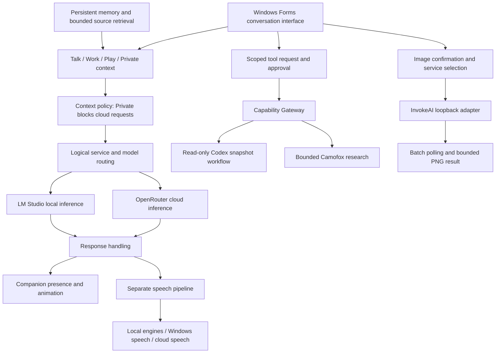

# Project 08 · Vesper Desktop AI Companion

**Status:** Working personal application with ongoing development  
**Platform:** Windows  
**Core implementation:** C# and Windows Forms  
**Author:** Kristian McKillip

## Overview

Vesper brings an interactive character, conversation, memory, speech, and AI tools into one desktop application. Working versions combine an animated companion and wardrobe with local and cloud model responses, contextual memory, speech playback, and local image generation.

The engineering work centers on coordinating those systems while keeping context, provider choice, permissions, cancellation, and version identity understandable. Newer changes are developed in isolated candidates while preserving the existing application.

I directed product requirements, companion interaction, feature priorities, and hands-on acceptance testing. AI coding tools assisted with implementation, debugging, and automated tests.

## Architecture at a glance

Model routing chooses a service; it does not grant tool authority. The separate tool branch shows Gateway-controlled workflows. Image generation and some provider-backed operations have separate controls and do not all pass through that Gateway. Context policy constrains provider routing; Private context blocks cloud requests. Newer attachment-disclosure work is tracked separately by checkpoint.

<strong>Technical components</strong>

### Companion and interface

The application separates its animated desktop presence from the conversation window. The companion supports window perching, movement, direct dragging, return-home behavior, wardrobe changes, and thinking, speaking, and resting states. Historical runtime logs record those interactions alongside model responses and speech playback.

Talk, Work, Play, and Private contexts have distinct memory and interaction behavior. Private context blocks cloud requests through application logic.

### Conversation, routing, and memory

A model registry and router select logical services separately from provider identity. Cost class, fallback, and escalation are distinct concepts. Implemented paths include local inference through LM Studio and cloud inference through OpenRouter.

A conversation passes from user input and context through relevant memory and bounded source retrieval, then service selection and response handling. Optional speech and companion-state updates follow. Timing records distinguish model-response delay from speech-generation and playback stages.

Attached-source retrieval limits file sizes, excerpts, text length, file count, and directory traversal. Later checkpoints add explicit disclosure controls and attachment-persistence repairs; those controls are not assumed to be accepted in every older build.

### Speech and images

Speech runs separately from model reasoning. Implemented paths include Windows speech, local neural engines, and a cloud speech provider. The pipeline supports chunking, prefetch, worker readiness, playback, cancellation, and owned helper processes.

The InvokeAI adapter connects to a loopback service, submits a fixed image workflow, polls its batch, retrieves bounded PNG output, and supports best-effort cancellation. Historical live-service logs contain successful image checks as well as failures and timeouts.

### Bounded tools and remote interface

- The Codex read workflow uses a Vesper-owned snapshot, fixed workspace, structured requests, restricted networking, bounded output, timeout, cancellation, and owned-process cleanup.
- Camofox research uses one-use approval, public-HTTPS restrictions, DNS and redirect checks, bounded actions, and cleanup.
- A Remote PWA and supporting authentication and protocol code provide another application interface.

The Capability Gateway evaluates grants bound to an actor, capability, operation, resource, expiry, and revocation state. Protected stores hold relevant provider credentials.

Backend implementation and user-facing acceptance are separate: the October review found that the Codex task viewer lacked a reachable UI caller and its snapshot path still had disclosure-policy gaps.

<strong>Verified development timeline</strong>

- **August 6–7, 2026:** Runtime logs record companion startup, wardrobe changes, window perching, dragging, home return, and completed LM Studio and OpenRouter replies.
- **August 11, 2026:** Two recorded live-service smoke runs completed successfully, including local image generation. Other recorded runs failed or timed out; this is historical execution evidence, not a blanket reliability claim.
- **September 8, 2026:** A repository-grounded inspection at `067f36d` documented the existing system architecture. The direct-C# build and offline validator passed with three pre-existing compiler warnings. This pass did not test live providers or physical audio.
- **October 8, 2026:** A read-only audit distinguished the primary project at `067f36d`, historical privacy work at `d21880a`, isolated product candidate `169e6d1`, and separate validation tooling. The audit confirmed substantial existing functionality while identifying candidate-only fixes and unresolved acceptance gates.
- **October 8, 2026:** Later isolated validation exercised attachment persistence, favorites, authentication, process ownership, voice, browser boundaries, and animation. The full run stopped at a file-symlink fixture; a diagnostic retry established an OS privilege denial. Independent passing checks remained partial coverage.
- **October 8–9, 2026 (UTC records):** A newer isolated candidate remained under evaluation, including response-handling behavior. It was not represented as an accepted replacement for the working application.

These dates identify observed checkpoints using the source records’ timestamps; UTC is stated where known. They do not assign undocumented completion dates to individual features or imply the user’s local calendar date.

<strong>Three engineering examples</strong>

### 1. Separating model choice from permission

**Problem:** An application with local models, cloud services, attached context, and tools needs separate answers to where a request runs and what it may access or do.

**My contribution and decision:** I set product requirements and evaluated the local/private experience. The development direction kept provider selection separate from tool permission rather than treating a selected model as automatically authorized.

**Implemented solution:** The router selects logical services and providers. Private context blocks cloud requests independently. The Capability Gateway binds supported tool operations to scoped, expiring, revocable grants. Browser and Codex adapters have their own bounded execution paths.

**Evidence and limits:** The September source inspection documented these controls and an offline validation pass. It also found incomplete Gateway coverage. Later attachment-disclosure work and the remaining Codex snapshot gap are tracked separately; the case study does not claim universal enforcement across every integration.

### 2. Coordinating replies, speech, and companion state

**Problem:** Model inference, speech synthesis, playback, and animation operate on different timelines. A visible response is not the same event as playable audio, and cancellation must account for work that is already queued.

**My contribution and decision:** I shaped the companion's interaction and voice experience and evaluated it in use. Development treated speech as a separate pipeline so the conversation model and voice implementation could change independently.

**Implemented solution:** Reply handling feeds companion activity states and an optional speech pipeline. Speech is chunked and prefetched, with worker readiness, playback stages, cancellation, and owned helper processes. Later isolated work added stale-audio ownership and terminal-rejection fixes.

**Evidence and limits:** August logs record local and cloud replies, chunked neural speech, playback completion, and return to a resting state. They also expose cold-start delays. This establishes working historical behavior, not a guaranteed latency target. Newer speech fixes and physical Stop-to-silence acceptance remain checkpoint-specific.

### 3. Making validation failures diagnosable without disturbing the working app

**Problem:** Isolated validation encountered inherited-environment conflicts, overlong Windows temporary paths, and a link-creation failure whose error output was initially discarded. Without reliable diagnostics, a fixture failure could be mistaken for an application defect or a successful partial run for full validation.

**My contribution and decision:** I approved bounded testing and reviewed its results while the working application was preserved. The development workflow kept product binaries, fixture repairs, and diagnostic tooling in distinguishable checkpoints.

**Implemented fixes:** The fixture child received a clean environment and shorter temporary paths. Diagnostic handling retained bounded stdout, stderr, and numeric exit codes before rejecting a failure. Guard tests checked denial handling, swallowed errors, timeouts, and leftover reporting.

**Evidence and limits:** Recorded checks include passing injected diagnostic tests and a separate passing continuation of the remaining checks. One instrumented retry established that Windows denied file-symlink creation. The full run remained failed; later passing checks were not relabeled as a full-suite pass. These repairs improved test evidence, not the application's claimed feature count.

## Verification and current limits

Historical runtime logs and the September baseline establish working companion behavior and implemented integrations. Later targeted checks cover newer development separately.

The latest candidate's full validation and attended acceptance are not claimed complete. Wardrobe favorites, attachment repairs, and newer speech/privacy changes belong to their specific candidate. The Job Queue is deliberately non-executing. General autonomous orchestration, an operational AgentSupervisor, and Blender/Higgsfield execution are not established features.

The current Claude adapter is mocked and unconfigured; no live Claude-provider operation is claimed.

## Contribution

My role combines product definition, interaction decisions, prioritization, and hands-on review of actual behavior. AI-assisted coding supported implementation and testing.
